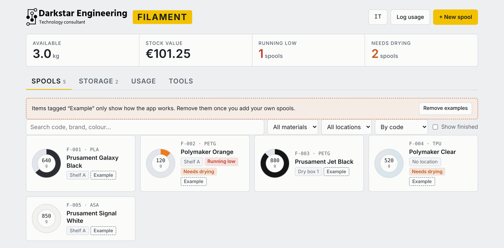

<p></p>

# Darkstar Filament Manager

A simple manager for 3D printing filament: spool inventory, storage locations, print usage, drying reminders and cost calculation.

It is a static web app made of plain HTML, CSS and JavaScript. There is no server, no database and nothing to install. Your data stays in your own browser. The interface is available in **English and Italian**.

🇮🇹 **[Leggi in italiano](#italiano)**

<picture>
  <source media="(prefers-color-scheme: dark)" srcset="docs/screenshot-dark.png">
  
</picture>

## Features

- **Spools:** for each spool you can record:
  - code (F-001…), brand, material, colour and diameter;
  - net weight, remaining filament, empty spool weight and price;
  - location, opened and dried dates, notes.

  Each spool is drawn as a ring in its own colour that empties as you use it.
- **Storage:** shelves, dry boxes, drawers and vacuum bags, with spool count and kilograms in each.
- **Usage log:** enter the grams PrusaSlicer reports, or the metres, which are converted automatically. The grams are subtracted from the spool and the cost is worked out. A chart shows the last 8 weeks, plus usage per material.
- **Alerts:**
  - *Running low* below a threshold you set.
  - *Needs drying* for moisture-sensitive materials (PETG, TPU, PA, PC, PVA) that have been open too long. The interval doubles for spools kept in a dry box.
- **Tools:**
  - print cost calculator (material plus energy);
  - metres ↔ grams converter by material and diameter;
  - weigh a spool on a scale (gross weight minus tare).
- **Backup:** export and import all your data as a JSON file.
- **Languages and themes:** English and Italian with an EN/IT switch, light and dark theme (automatic or chosen with the theme button), works on phones.

## Getting started

### Option 1: run it on your computer
1. On this page click **Code → Download ZIP**.
2. Unzip it anywhere.
3. Double-click `index.html`. It opens in your browser and works offline. Without a connection, the fonts are simply replaced by system fonts.

### Option 2: put your own copy online with GitHub Pages (free)
1. Click **Fork** at the top right to copy this repository to your account.
2. In your fork go to **Settings → Pages**.
3. Under **Build and deployment** set **Source** to **Deploy from a branch**, then choose branch **main** and folder **/ (root)**, and click **Save**.
4. After a minute or two your copy is live at `https://<your-username>.github.io/darkstar-filament-manager/`.

### Option 3: any other static hosting
Upload the files (`index.html`, `style.css`, `app.js`, `logo.png`, `favicon.svg`) to any web hosting: Netlify (drag and drop the folder), Cloudflare Pages, your own server or NAS. No build step is needed.

## First steps

1. Open **Storage** and create your locations, for example "Shelf A" or "Dry box 1".
2. Click **+ New spool** and fill in brand, material, colour, net weight, empty spool weight and price.
3. After each print click **Log usage** and enter the grams from PrusaSlicer.
4. Now and then weigh your spools (**Tools → Weigh a spool**) to correct the remaining amount.
5. Export a backup from time to time (**Tools → Backup**).

Want to look around first? With an empty archive click **Load sample data**, then remove it with **Remove examples**.

## Where your data is stored

Everything is saved in your browser's `localStorage` under the key `darkstar-filamenti:v1`. This means:

- each browser and each device has its own separate archive;
- clearing your browsing data deletes the archive, so keep a backup;
- to move your data to another device, use **Export backup** and then **Import backup** on the other device.

Nothing is sent anywhere. If you host your own copy online, every visitor gets their own empty archive.

## Customising

| What | Where |
|---|---|
| Materials and densities (g/cm³) | `MAT` constant in `app.js` |
| Moisture-sensitive materials | `HYGRO` constant in `app.js` |
| Printers in the drop-down | `PRINTERS` constant in `app.js` |
| All interface text | `I18N` object in `app.js`. To add a language, copy the `en` block under a new key |
| Colours and fonts | tokens at the top of `style.css` |
| Logo | replace `logo.png` |

## File structure

```
index.html      page structure
style.css       styling, light and dark themes
app.js          logic, storage, backup, translations
logo.png        logo
docs/           screenshots for this README
favicon.svg     browser tab icon
```

## License

MIT, see [LICENSE](LICENSE). You are free to use, modify and share it.

---

<a id="italiano"></a>

# 🇮🇹 Italiano

Un gestionale semplice per i filamenti di stampa 3D: inventario delle bobine, magazzini, consumi di stampa, promemoria di essiccazione e calcolo dei costi.

È un'app web statica, fatta solo di HTML, CSS e JavaScript. Non ci sono server, database o installazioni. I dati restano nel tuo browser. L'interfaccia è in **italiano e inglese**.

## Funzioni

- **Bobine:** per ogni bobina puoi registrare:
  - codice (F-001…), marca, materiale, colore e diametro;
  - peso netto, residuo, tara della bobina vuota e prezzo;
  - ubicazione, date di apertura e di essiccazione, note.

  Ogni bobina è disegnata come un anello del suo colore che si svuota con l'uso.
- **Magazzini:** scaffali, dry box, cassetti e sacchetti sottovuoto, con il numero di bobine e i kg presenti in ciascuno.
- **Consumi:** inserisci i grammi indicati da PrusaSlicer, oppure i metri, che vengono convertiti in automatico. I grammi vengono scalati dalla bobina e il costo calcolato. Un grafico mostra le ultime 8 settimane, insieme ai consumi per materiale.
- **Avvisi:**
  - *In esaurimento* sotto una soglia che decidi tu.
  - *Da essiccare* per i materiali igroscopici (PETG, TPU, PA, PC, PVA) aperti da troppo tempo. L'intervallo raddoppia per le bobine in dry box.
- **Strumenti:**
  - calcolo del costo di stampa (materiale più energia);
  - convertitore metri ↔ grammi per materiale e diametro;
  - pesata con la bilancia (peso lordo meno tara).
- **Backup:** esportazione e importazione di tutti i dati in un file JSON.
- **Lingue e temi:** italiano e inglese con il pulsante IT/EN, tema chiaro e scuro (automatico o scelto con il pulsante del tema), funziona anche da telefono.

## Come iniziare

### Opzione 1: sul tuo computer
1. In questa pagina premi **Code → Download ZIP**.
2. Estrai lo ZIP dove vuoi.
3. Fai doppio clic su `index.html`. Si apre nel browser e funziona anche senza internet. Senza connessione, i font vengono semplicemente sostituiti da quelli di sistema.

### Opzione 2: una tua copia online con GitHub Pages (gratis)
1. Premi **Fork** in alto a destra per copiare il repository sul tuo account.
2. Nel tuo fork vai in **Settings → Pages**.
3. In **Build and deployment** imposta **Source** su **Deploy from a branch**, poi scegli il branch **main** e la cartella **/ (root)** e premi **Save**.
4. Dopo un paio di minuti la tua copia è online su `https://<tuo-utente>.github.io/darkstar-filament-manager/`.

### Opzione 3: qualsiasi altro hosting statico
Carica i file (`index.html`, `style.css`, `app.js`, `logo.png`, `favicon.svg`) su un hosting qualsiasi: Netlify (trascini la cartella), Cloudflare Pages, il tuo server o NAS. Non serve nessuna compilazione.

## Primi passi

1. Apri **Magazzini** e crea le tue ubicazioni, per esempio "Scaffale A" o "Dry box 1".
2. Premi **+ Nuova bobina** e inserisci marca, materiale, colore, peso netto, tara della bobina vuota e prezzo.
3. Dopo ogni stampa premi **Registra consumo** e inserisci i grammi indicati da PrusaSlicer.
4. Ogni tanto pesa le bobine (**Strumenti → Pesata bobina**) per correggere il residuo.
5. Esporta un backup di tanto in tanto (**Strumenti → Backup**).

Vuoi prima dare un'occhiata? Con l'archivio vuoto premi **Carica dati di esempio**, poi li togli con **Elimina esempi**.

## Dove finiscono i dati

Tutto viene salvato nel `localStorage` del browser, con la chiave `darkstar-filamenti:v1`. Questo significa che:

- ogni browser e ogni dispositivo ha il proprio archivio separato;
- se cancelli i dati di navigazione, l'archivio si perde, quindi tieni un backup;
- per spostare i dati su un altro dispositivo usa **Esporta backup** e poi **Importa backup** sull'altro.

Nessun dato viene inviato altrove. Se pubblichi online la tua copia, ogni visitatore parte con il proprio archivio vuoto.

## Personalizzazione

| Cosa | Dove |
|---|---|
| Materiali e densità (g/cm³) | costante `MAT` in `app.js` |
| Materiali igroscopici | costante `HYGRO` in `app.js` |
| Stampanti nel menu | costante `PRINTERS` in `app.js` |
| Tutti i testi dell'interfaccia | oggetto `I18N` in `app.js`. Per aggiungere una lingua copia il blocco `en` con una nuova chiave |
| Colori e font | variabili in cima a `style.css` |
| Logo | sostituisci `logo.png` |

## Licenza

MIT, vedi [LICENSE](LICENSE). Puoi usarlo, modificarlo e condividerlo liberamente.
